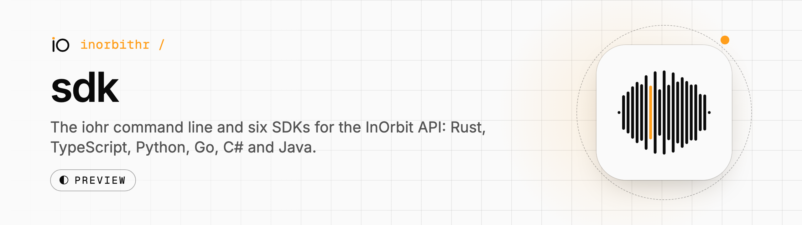

<p align="center">
  <picture>
    <source media="(prefers-color-scheme: dark)" srcset=".github/assets/hero-dark.png">
    
  </picture>
</p>

# InOrbit SDK

The `iohr` command line and the official client libraries for the
[InOrbit API](https://docs.inorbit.hr). Use them to call InOrbit from your own code and
pipelines. Everything here is pre-1.0: `iohr` ships as a pre-release.

Each library is a hand-written runtime plus an API surface that `iohr sdk generate` writes,
cut to what your credentials may call ([ADR 0011](docs/adr/0011-runtime-and-surface.md)).
The released libraries pass the shared conformance suite, streams included (server-sent events or one
`/v1/ws` socket, [design.md](docs/design.md) section 7).

- On their registries: Rust, TypeScript, Python and Go.
- Built from source until their registry releases: C# and Java ([roadmap](docs/roadmap.md), M4b).
- Not released yet: Swift (a SwiftPM package at this repository's root, [swift/README.md](swift/README.md)) and Dart (the contract and its checker so far).

The versions below are read live from each registry, or from the repository's release
tags where there is no registry release, so the table does not go stale between releases:

| Part | Package | Latest release |
|---|---|---|
| Command line | `iohr` (APT, Homebrew, installers, [GitHub releases](https://github.com/inorbithr/sdk/releases?q=iohr)) | [](https://github.com/inorbithr/sdk/releases?q=iohr), pre-release |
| Rust | [`inorbithr`](https://crates.io/crates/inorbithr), Rust 1.94 | [](https://crates.io/crates/inorbithr) |
| TypeScript | [`@inorbithr/sdk`](https://www.npmjs.com/package/@inorbithr/sdk), Node 22.12, Bun, Deno, browsers | [](https://www.npmjs.com/package/@inorbithr/sdk) [](https://jsr.io/@inorbithr/sdk) |
| Go | [`github.com/inorbithr/sdk/go`](https://pkg.go.dev/github.com/inorbithr/sdk/go), Go 1.26 | [](https://pkg.go.dev/github.com/inorbithr/sdk/go) |
| Go, OpenTelemetry | [`github.com/inorbithr/sdk/go/otel`](https://pkg.go.dev/github.com/inorbithr/sdk/go/otel), an optional module for spans and metrics | [](https://pkg.go.dev/github.com/inorbithr/sdk/go/otel) |
| Python | [`inorbithr`](https://pypi.org/project/inorbithr/), Python 3.11 | [](https://pypi.org/project/inorbithr/) |
| C# | `InOrbit.Sdk`, .NET 8 | [](https://github.com/inorbithr/sdk/releases?q=csharp), built from source; not on NuGet yet |
| Java | `hr.inorbit:inorbit-sdk`, Java 17 | [](https://github.com/inorbithr/sdk/releases?q=java), built from source; not on Maven Central yet |
| Swift | SwiftPM `https://github.com/inorbithr/sdk`, product `InOrbit`; iOS 15, macOS 12, Linux | not released yet; depend on `main` ([swift/README.md](swift/README.md)) |
| Dart | `inorbit`, Dart 3.9 and Flutter: the contract and its checker so far, the client follows | not released; not on pub.dev yet ([`dart/`](dart/)) |

The contract the libraries are built against is synced from the platform into
[`spec/`](spec/), and the replay server in
[`conformance/`](conformance/) runs the shared behaviour cases. [docs/roadmap.md](docs/roadmap.md)
has the milestones.

## The command line

```sh
# macOS and Linux, Homebrew. Homebrew refuses a tap it was not told to trust, so once
# per Mac (or Linux box) run `brew trust` before the install:
brew trust inorbithr/tap
brew install inorbithr/tap/iohr

# later: iohr upgrade (iohr upgrade --check only looks)

# Debian and Ubuntu: the repository is signed by the key with fingerprint
# 5FF6 7AF3 D50A 6B06 FFE6  EA8A FFA5 11CF 585B F28D
sudo install -d -m 0755 /etc/apt/keyrings
curl -fsSL https://packages.inorbit.hr/iohr.gpg | sudo tee /etc/apt/keyrings/iohr.gpg >/dev/null
printf 'Types: deb\nURIs: https://packages.inorbit.hr/apt\nSuites: stable\nComponents: main\nSigned-By: /etc/apt/keyrings/iohr.gpg\n' \
  | sudo tee /etc/apt/sources.list.d/iohr.sources >/dev/null
sudo apt update && sudo apt install iohr

# Any Linux or macOS, for your user only, no sudo
curl -fsSL https://packages.inorbit.hr/install.sh | sh
```

On Windows, `install.ps1` from the same host installs it for your user. Then:

```sh
iohr login        # signs you in through your browser, or with a device code over SSH
iohr whoami
iohr api GET /v1/me
```

`iohr` keeps several accounts as profiles, creates and revokes API tokens, proves
domains, connects an account's apps (`iohr connectors`, `iohr connections`: a key or a
browser sign-in), installs signed extensions such as the InOrbit agent (`iohr ext`),
checks Lab documents (`iohr lab check`), keeps RFCs, PRDs and ADRs in the Decisions product (`iohr decisions`) and
runs coordinator turns on your own Claude subscription (`iohr runner`).
It talks to `api.inorbit.hr` and
`auth.inorbit.hr`, and to the extension registry only in `iohr ext install`, `upgrade` and
`sync` ([ADR 0012](docs/adr/0012-extensions.md)). What leaves your machine, including a
running runner's upgrade checks, is in [SECURITY.md](SECURITY.md), section "What leaves
your machine"; every host it reaches is in
[cli/docs/files-and-dependencies.md](cli/docs/files-and-dependencies.md#the-hosts-it-talks-to). Releases before 1.0 are pre-releases. Every release carries checksums, an SBOM and build provenance you can
check with `gh attestation verify`. [cli/README.md](cli/README.md) is the guide, and [cli/docs/commands.md](cli/docs/commands.md) has every command.

### Start a project, ask your agent

```sh
iohr init my-shop                 # a project from a template, with a Planner plan and the enterprise floor
iohr atlas search "refund policy" # search the text of the site init read (local, no model)
iohr sync                         # send the project's atlas to your account

eval "$(iohr shell hook zsh)"     # once, in ~/.zshrc: the ? prompt
? why did that fail               # ask your own AI agent about this folder
?? and the second one             # a follow-up with the last question and answer
```

- `iohr init` (also `iohr project init`) sets up a project from one of seven templates
  (`blank`, `service`, `mcp-server`, `agent`, `evals`, `cli`, `extension`) or from a
  description your agent builds, reads your public site into a local site knowledge base
  (the atlas, searchable with `iohr atlas search`, `facts` and `index`), and keeps the
  project's data outside the repository ([Projects](cli/docs/projects.md)).
- `?` and `??` ask Claude Code or Codex on this machine, answered by the project's Roles
  (`--role`, `iohr atlas roles import`). The agent reads folders you allow and asks before
  it runs a command your rules do not cover. `IO.md` files up the folder chain add
  instructions, and `iohr context` shows what a question would load
  ([Asking your agent](cli/docs/ask.md), [Roles and memory](cli/docs/roles-and-memory.md)).
- `iohr asks` lists the questions and approvals agents file for you; on a Mac you can
  approve with Touch ID. `iohr session` and `iohr stop` run a project's Roles, and bare
  `iohr` opens your shell in the session with a floating panel
  ([Sessions and the panel](cli/docs/session-and-panel.md)).
- `iohr theme` gives Terminal.app the InOrbit app's terminal themes
  ([the terminal theme](cli/docs/terminal-theme.md)).

The `?` prompt supports zsh only so far; bash and fish are not built.

### The web UI

```sh
iohr ui          # serve the built page on loopback and open it in your browser
```

`iohr ui` serves a welcome page, Settings and the panels of your installed extensions from
your own machine. The page never holds a credential: the local server signs in as
`iohr login` does and reads the API for it, GET only. It is built from [`ui/`](ui/) (RFC 0217);
[ui/README.md](ui/README.md) covers running, developing and checking it, and
[ui/docs/](ui/docs/) has one guide each for the architecture, pages, API and proxy,
shortcuts, theming and contributing. More pages (atlas, teams, planner, sensors, canvas,
decisions, live) are in open pull requests and are not part of it yet.

## Add a library to your project

```sh
iohr sdk add        # cargo add, npm install, pnpm/yarn/bun/deno add, uv/poetry/pdm add, pip or go get, from your project's files
```

The command is printed, then run by your project's own package manager
([cli/docs/sdk.md](cli/docs/sdk.md#add-the-sdk-to-a-project)).

## Generate a client for your account

```sh
iohr login
iohr sdk generate --lang rust --for default --out src/iohr   # or typescript, go, python, csharp, java, swift
```

The generated code holds only the operations your profile's credential may call, so a call
it may not make fails to compile (in TypeScript, Rust, Go, C#, Java, Swift; in Python, the type checker).
Commit it with the `iohr.lock` beside it and run `iohr sdk check` in CI: it fails, with a
diff, when what the credential may call changes. The guide is at
[docs.inorbit.hr/docs/sdk](https://docs.inorbit.hr/docs/sdk/).

## What every library does

- Authenticate with an API token, or exchange an API key for a short-lived token, cache
  it and refresh it, so you never handle the exchange yourself.
- Return typed results and one error type per language, carrying the API's error `code`
  and `details`; a code the library does not know yet is kept, not dropped.
- Retry what is safe to retry (`429`, `503`, `504`, connection failures), honouring
  `Retry-After`; a write is retried only when the operation is marked safe to repeat.
- Behave the same in every language: one set of [conformance cases](conformance/) runs
  against all of them.

See [docs/design.md](docs/design.md) for the library design.

## Repository layout

| Path | Contents |
|---|---|
| [`cli/`](cli/) | The `iohr` command line, its release scripts and packaging |
| [`ui/`](ui/) | The web UI `iohr ui` serves: a private Vite and React package, with [guides](ui/docs/) |
| [`spec/`](spec/) | The API contract, synced from the platform |
| [`conformance/`](conformance/) | Shared behaviour cases and the replay server every SDK runs them against |
| [`rust/`](rust/), [`typescript/`](typescript/), [`go/`](go/), [`python/`](python/), [`csharp/`](csharp/), [`java/`](java/), [`swift/`](swift/) | One runtime per language, with its generated public surface; Swift's `Package.swift` is at the root |
| [`dart/`](dart/) | The Dart runtime, started: the contract and the answer checker (platform RFC 0074.8) |
| [`examples/`](examples/) | Small programs that CI compiles |
| [`docs/`](docs/) | Design, decisions (ADRs), releasing, style |

## Security

- Report vulnerabilities privately: [SECURITY.md](SECURITY.md), or the contact in
  [security.txt](https://inorbit.hr/.well-known/security.txt).
- Supported versions: [SUPPORT.md](SUPPORT.md). Before 1.0 only the latest release gets
  fixes; the security support period starts with 1.0.
- Requirements, threat model, controls and how to verify releases:
  [docs/security/](docs/security/).

## Contributing

See [CONTRIBUTING.md](CONTRIBUTING.md).

## License

[Apache License 2.0](LICENSE).
